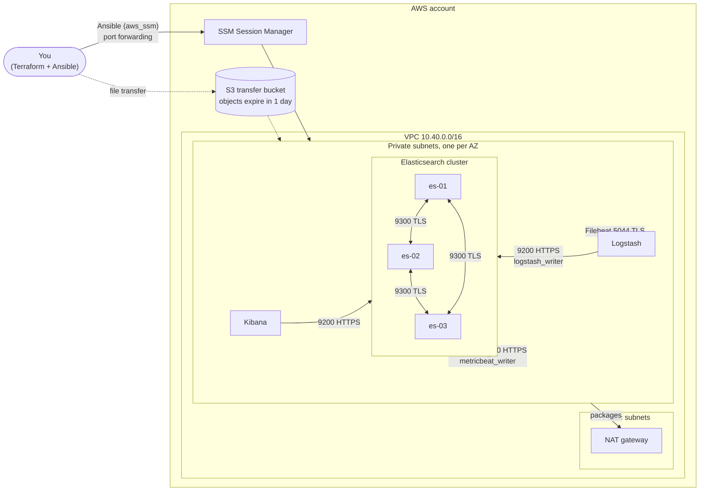

# Elastic Stack on AWS with Terraform and Ansible

A production-shaped Elastic Stack (Elasticsearch, Kibana, Logstash, Filebeat,
Metricbeat) on AWS. Terraform builds the network and instances; Ansible
configures the stack over **AWS Systems Manager**. No instance has a public IP,
no security group opens SSH, and every connection between components is TLS
with full certificate verification.



Every node runs Filebeat (logs → Logstash → Elasticsearch) and Metricbeat
(system metrics plus Stack Monitoring for the component on that node), so the
cluster monitors itself from the moment it comes up.

## Design choices

| Decision | Why |
| --- | --- |
| **SSM instead of SSH** | No keys to manage or leak, no port 22, no bastion. Access is IAM-controlled and logged in CloudTrail. Kibana is reached by SSM port forwarding. |
| **Dynamic inventory** | Terraform writes an `aws_ec2` inventory config that finds instances by tag and groups them by role. Nothing hand-maintained, no IPs in the repo. |
| **Certificates generated locally** | A small CA and per-host certs are built on the controller with `community.crypto` and pushed to nodes. Keys never leave your machine except to the node that owns them. |
| **Secrets in keystores, not config files** | Passwords and encryption keys go into the Elasticsearch, Kibana, Logstash and Metricbeat keystores. The test suite fails if any secret appears in a rendered config file. |
| **Least-privilege shipper users** | Logstash and Metricbeat write with dedicated users that can only create documents in their own indices, not the `elastic` superuser. |
| **Security groups reference security groups** | No ingress rule uses a CIDR. Only the component that needs a port can reach it. |
| **AZ-aware shard allocation** | Elasticsearch nodes are spread across three AZs and tagged with their zone, so primaries and replicas land in different AZs. |

## Prerequisites

- Terraform ≥ 1.7 and an AWS account with credentials configured
- Python 3.10+ with `ansible-core` ≥ 2.16, `boto3` and `botocore`
- The [Session Manager plugin](https://docs.aws.amazon.com/systems-manager/latest/userguide/session-manager-working-with-install-plugin.html) for the AWS CLI

```bash
pip install ansible-core boto3 botocore
make deps        # Ansible collections
```

## Deploy

```bash
# 1. Infrastructure
cp terraform/terraform.tfvars.example terraform/terraform.tfvars   # adjust
make init plan apply

# 2. Secrets: random passwords, encrypted with a vault password you choose
make vault

# 3. Configure the stack (about 10–15 minutes on a fresh cluster)
make inventory   # should list elasticsearch, kibana and logstash groups
make deploy

# 4. Check it end to end
make verify
```

Open Kibana:

```bash
make kibana      # starts an SSM port-forwarding session
```

Then browse to <https://localhost:5601> and sign in as `elastic`
(`ansible-vault view ansible/inventory/group_vars/all/vault.yml` shows the
password). The certificate is signed by the stack's own CA, at
`ansible/.certs/ca/ca.crt`; trust it or accept the browser warning.

Rerun parts of the deployment with tags:

```bash
make deploy ANSIBLE_ARGS="--tags kibana"
```

### Cost

The default layout (3 × `m6i.large`, `t3.medium`, `t3.large`, one NAT gateway)
is roughly **$11–13 per day** in `us-east-1`. For a cheap demo, set
`es_node_count = 1`, `az_count = 1` and `es_instance_type = "t3.large"`.
Run `make destroy` when you're done.

## Tests

| Layer | What runs | Needs AWS? |
| --- | --- | --- |
| `terraform test` | Plan-level assertions with mocked providers: no public IPs, IMDSv2 only, encrypted volumes, no CIDR or SSH ingress, locked-down default SG and S3 bucket, input validation | No |
| `tests/ansible/render_test.yml` | Generates real certificates and checks the chain, SANs, key types and permissions, and that a rerun doesn't regenerate them. Renders every template for a 3-node and a 1-node topology and checks TLS settings, users, topology, and that **no secret appears in any config file** | No |
| `ansible-lint` (production profile), `yamllint`, `tflint`, `checkov`, `shellcheck` | Static analysis | No |
| `gitleaks` | Secret scanning in CI and as a pre-commit hook | No |
| `ansible/verify.yml` | Smoke test against the live stack: cluster green with all nodes, plain HTTP refused, anonymous requests rejected, shipper users can authenticate but not administer the cluster, logs and monitoring data arriving, Kibana requires login, Logstash API not exposed | Yes |

```bash
make test    # offline tests
make lint
make scan    # gitleaks + checkov
```

Install the pre-commit hooks to catch secrets before they're committed,
including a check that refuses an unencrypted vault file:

```bash
pip install pre-commit && pre-commit install
```

## Repository layout

```
terraform/          VPC, security groups, IAM, S3, EC2; writes the Ansible inventory
  tests/            terraform test with mocked providers
ansible/
  site.yml          full deployment
  verify.yml        post-deploy smoke tests
  inventory/        group_vars and (generated) aws_ec2 inventory
  roles/
    elk_certs       CA and host certificates, built locally
    common          hostname, time sync, Elastic apt repo, CA trust
    elasticsearch   cluster config, TLS, keystore, health check
    es_security     built-in user passwords, least-privilege roles and users
    kibana          TLS, keystore secrets, health check
    logstash        Beats input over TLS, protected keystore
    filebeat        modules per host role, index templates and pipelines
    metricbeat      system metrics and Stack Monitoring per host role
tests/ansible/      offline render and certificate tests
scripts/            vault generator
```

## Security notes

- **What's never committed:** the vault file, generated certificates and keys,
  Terraform state and tfvars, and the generated inventory are all in
  `.gitignore`. gitleaks runs in CI and as a pre-commit hook.
- **Rotating a secret:** keystore entries are only added when missing, so a
  changed vault value doesn't silently restart services. To rotate, remove the
  entry from the relevant keystore on the host and rerun the role.
- **Kibana access** is only through SSM port forwarding; there is no load
  balancer. Put an ALB with an ACM certificate and OIDC/SAML in front of it for
  real users.
- **Restarts are not rolling.** A config change restarts all Elasticsearch
  nodes together, which is fine for a demo but causes a brief outage. A rolling
  restart playbook is the natural next step for production use.

## Roadmap

- Rolling restart and rolling upgrade playbooks
- Snapshot repository on S3 with an SLM policy
- Separate data volumes and dedicated master nodes for larger clusters
- ALB with OIDC in front of Kibana

## License

MIT
