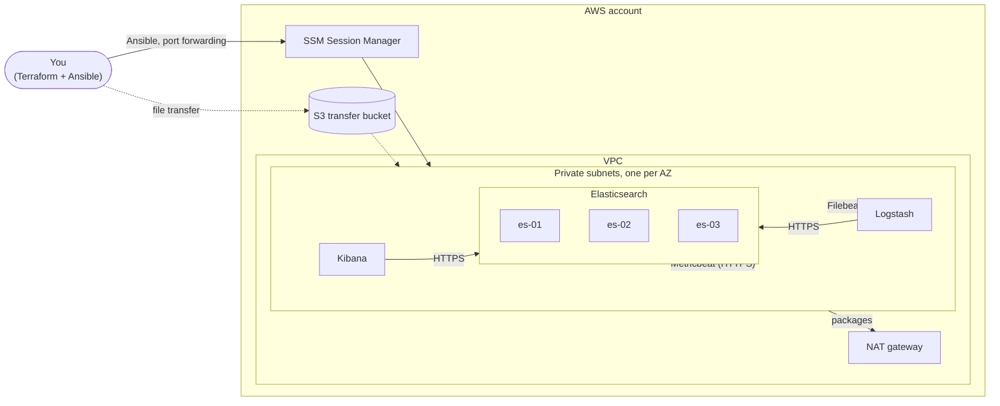

# Elastic Stack on AWS with Terraform and Ansible

By [Zachary Adams](https://github.com/peacedouts)

Terraform builds the network and instances. Ansible configures Elasticsearch,
Kibana, Logstash, Filebeat and Metricbeat over AWS Systems Manager. Nothing
has a public IP, there's no SSH, and every connection between components uses
TLS with full certificate verification.



Every node runs Filebeat and Metricbeat, so the cluster ships its own logs and
Stack Monitoring data from the start.

## How it's built

- **SSM, not SSH.** No keys, no port 22, no bastion. Access goes through IAM
  and shows up in CloudTrail. Kibana is reached with SSM port forwarding.
- **No hand-written inventory.** Terraform generates an `aws_ec2` inventory
  that finds instances by tag and groups them by role.
- **Certificates built locally.** A small CA and per-host certs are generated
  on your machine. The CA key never leaves it, and each node gets only its
  own key. Nodes have no S3 permissions, so they can't see each other's files
  in the transfer bucket.
- **Secrets live in keystores.** Passwords and encryption keys go into each
  service's keystore, never into config files or command lines. Tests fail
  if one shows up in a rendered file or a task passes one through
  `environment:`.
- **Least-privilege writers.** Logstash and Metricbeat write with dedicated
  users that can only append documents to their own data streams.
- **Tight security groups.** Rules reference other security groups, never CIDR
  ranges, so only the component that needs a port can reach it.
- **Spread across AZs.** Elasticsearch nodes sit in three AZs with zone-aware
  shard allocation, so a primary and its replica never share an AZ.

## Prerequisites

- Terraform 1.7 or newer, and AWS credentials
- Python 3.10+ with `ansible-core` 2.16+, `boto3` and `botocore`
- The [Session Manager plugin](https://docs.aws.amazon.com/systems-manager/latest/userguide/session-manager-working-with-install-plugin.html) for the AWS CLI

```bash
pip install ansible-core boto3 botocore
make deps
```

## Deploy

```bash
cp terraform/terraform.tfvars.example terraform/terraform.tfvars
make init plan apply   # infrastructure
make vault             # random secrets, encrypted with a password you pick
make inventory         # should show elasticsearch, kibana and logstash
make deploy            # about 10 to 15 minutes on a fresh cluster
make verify            # end-to-end smoke test
```

To open Kibana, run `make kibana` and browse to <https://localhost:5601>. Sign
in as `elastic`; `ansible-vault view ansible/inventory/group_vars/all/vault.yml`
shows the password. The browser will warn about the certificate unless you
trust `ansible/.certs/ca/ca.crt`.

Rerun one part with tags, e.g. `make deploy ANSIBLE_ARGS="--tags kibana"`.

**Cost:** the default layout runs about $11 to $13 a day in `us-east-1`. For a
cheap demo, set `es_node_count = 1`, `az_count = 1` and
`es_instance_type = "t3.large"`. Run `make destroy` when you're done.

## Tests

`make test` runs everything that doesn't need AWS:

- **`terraform test`** with mocked providers checks there are no public IPs,
  IMDSv2 is required, volumes are encrypted, no ingress uses a CIDR or port 22,
  the default security group and S3 bucket are locked down, and bad inputs are
  rejected.
- **`tests/ansible/render_test.yml`** generates real certificates and checks
  the chain, SANs, key format and permissions, and that a rerun keeps them. It
  then renders every template for a 3-node and a 1-node cluster and checks TLS,
  users and topology, and that no secret shows up in any config file.

`make lint` runs `ansible-lint` (production profile), `yamllint`, `tflint` and
`terraform validate`. `make scan` runs `gitleaks` and `checkov`. CI runs all
of it on every push.

Once the stack is up, `make verify` checks the live cluster: all nodes joined
and green, plain HTTP and anonymous requests refused, shipper users able to
write but not administer, logs and monitoring data arriving, Kibana requiring
a login, and the Logstash API staying on localhost.

The pre-commit hooks catch secrets before they're committed and refuse an
unencrypted vault file:

```bash
pip install pre-commit && pre-commit install
```

## Layout

```
terraform/          VPC, security groups, IAM, S3, EC2; writes the inventory
  tests/            terraform test with mocked providers
ansible/
  site.yml          full deployment
  verify.yml        smoke tests against the live stack
  roles/
    elk_certs       CA and host certificates, built locally
    common          hostname, time sync, Elastic apt repo
    elasticsearch   cluster config, TLS, keystore
    es_security     built-in passwords, roles and writer users
    kibana          TLS and keystore secrets
    logstash        Beats input over TLS, protected keystore
    filebeat        per-host modules, templates and ingest pipelines
    metricbeat      system metrics and Stack Monitoring
tests/ansible/      offline render and certificate tests
scripts/            vault generator
```

## Good to know

- The vault file, certificates, Terraform state, tfvars and the generated
  inventory are all gitignored.
- Keystore entries are only added when missing, so changing a vault value
  doesn't quietly restart services. To rotate a secret, remove the entry from
  the keystore on the host and rerun the role.
- Kibana has no load balancer. For real users, put an ALB with an ACM
  certificate and OIDC or SAML in front of it.
- Config changes restart all Elasticsearch nodes at once. That's fine for a
  demo; production wants a rolling restart.

## Next up

- Rolling restart and upgrade playbooks
- S3 snapshot repository with an SLM policy
- Dedicated master nodes and separate data volumes for bigger clusters
- ALB with OIDC in front of Kibana

## License

MIT
